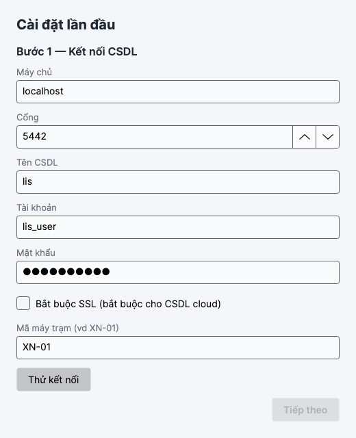
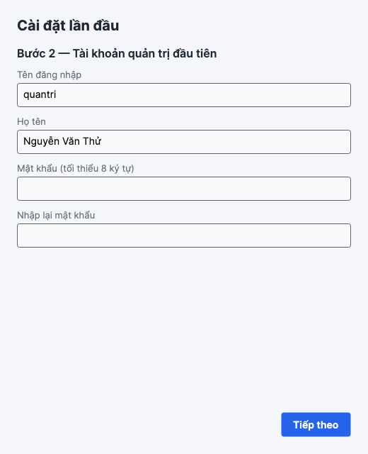
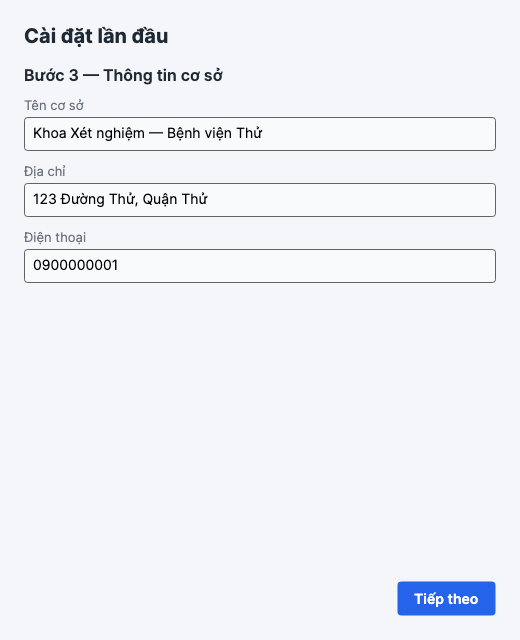

# Cài đặt LIS Connect

Dành cho người phụ trách cài đặt (IT / quản trị hệ thống). Tài liệu này hướng dẫn cài đặt chi
tiết trên Windows, kể cả khi triển khai nhiều máy trạm hoặc dùng CSDL trên cloud.

## 1. Yêu cầu máy

- **Windows**: 10 hoặc 11, bản 64-bit (x64). Ứng dụng là một tệp `.exe` tự chứa (self-contained),
  không cần cài .NET Runtime riêng.
- **RAM**: 4 GB tối thiểu, khuyến nghị 8 GB.
- **Ổ cứng**: 2 GB trống cho ứng dụng; CSDL PostgreSQL cần thêm dung lượng tùy số lượng mẫu/kết
  quả lưu trữ (tính theo nhu cầu riêng của mỗi cơ sở).
- **PostgreSQL**: bản 16.0 hoặc cao hơn — có thể cài trên cùng máy, trên một máy chủ khác trong
  mạng LAN, hoặc dùng dịch vụ CSDL trên cloud.
- **.NET 10 SDK**: chỉ cần nếu build từ mã nguồn (xem mục 4b); không cần nếu dùng bản `.zip` dựng sẵn.

## 2. Mô hình triển khai

LIS Connect là ứng dụng desktop (Avalonia), mỗi máy trạm chạy một bản `LisConnect.exe`, tất cả
máy trạm nối tới **một CSDL PostgreSQL duy nhất**. Ba cách bố trí:

1. **Một máy** — PostgreSQL và `LisConnect.exe` cùng cài trên một máy (phòng xét nghiệm nhỏ, 1
   người dùng). Kết nối CSDL khai `Host=localhost`.
2. **Nhiều máy trạm dùng chung một CSDL** — PostgreSQL cài trên một máy chủ (hoặc máy trạm đầu
   tiên) trong mạng LAN; các máy trạm khác chỉ cài `LisConnect.exe`, khai `Host=<địa chỉ IP máy
   chủ PostgreSQL>`. Cần mở tường lửa và sửa `pg_hba.conf`/`postgresql.conf` trên máy chủ CSDL —
   xem mục 6.
3. **CSDL trên cloud** — PostgreSQL chạy ở một dịch vụ cloud (ví dụ máy chủ cloud riêng có cài
   PostgreSQL, hoặc dịch vụ PostgreSQL quản lý). Mọi máy trạm (tại cơ sở hoặc từ xa) nối qua
   Internet — **bắt buộc bật SSL** (xem mục 7). Việc đồng bộ thật với HIS trung tâm (kéo chỉ
   định, đẩy kết quả) chưa có ở Đợt 1 — xem [`README.md`](README.md#phạm-vi-phiên-bản-hiện-tại-đợt-1--nền-tảng).

Dù chọn mô hình nào, chỉ cần **chạy wizard cài đặt lần đầu một lần** (ở máy đầu tiên khởi tạo
CSDL) — các máy trạm sau chỉ cần nhập đúng thông tin kết nối tới CSDL đã có.

## 3. Cài PostgreSQL 16+ trên Windows

1. Tải bộ cài chính thức: https://www.postgresql.org/download/windows/ — chọn **PostgreSQL 16.x**
   (hoặc cao hơn), **Interactive installer**.
2. Chạy trình cài đặt:
   - Đường dẫn cài đặt: giữ mặc định (`C:\Program Files\PostgreSQL\16`) trừ khi có yêu cầu khác.
   - Thành phần cài: giữ mặc định (PostgreSQL Server, pgAdmin, Command Line Tools, Stack Builder
     có thể bỏ qua).
   - Thư mục dữ liệu: giữ mặc định.
   - **Mật khẩu tài khoản `postgres`**: nhập và **ghi lại** — dùng ở bước tạo CSDL/người dùng.
   - **Cổng**: giữ mặc định `5432` trừ khi cổng này đã dùng cho mục đích khác.
   - **Locale**: chọn `Vietnamese, Vietnam` hoặc `UTF-8` (`en_US.UTF-8` cũng được — ứng dụng
     không phụ thuộc locale hệ CSDL, chỉ cần CSDL là UTF-8).
3. Hoàn tất cài đặt, bộ cài tự khởi động dịch vụ Windows `postgresql-x64-16`.

## 4a. Lấy bản build sẵn (khuyến nghị — không cần cài .NET SDK)

1. Tải tệp `LisConnect-win-x64.zip` — từ workflow CI (`.github/workflows/build.yml`, job
   `publish-win-x64`) hoặc từ bản phát hành do IT phân phối.
2. Giải nén vào thư mục bạn chọn, ví dụ `C:\LisConnect`. Cấu trúc sau khi giải nén:
   ```
   C:\LisConnect\
   ├── app\
   │   └── LisConnect.exe          (và các tệp hỗ trợ)
   ├── seedtool\
   │   └── Lis.SeedTool.exe
   ├── mau-danh-muc.xlsx           (tệp mẫu danh mục, dùng để nhập Excel)
   └── CHAY-THU-WINDOWS.md
   ```

## 4b. Build từ mã nguồn (cần .NET 10 SDK, tốn thêm 5–10 phút)

1. Cài **Git**: https://git-scm.com/download/win (nếu chưa có).
2. Cài **.NET 10 SDK**: https://dotnet.microsoft.com/en-us/download/dotnet/10.0 — chọn
   **Windows x64 Installer**, cài bình thường (tự thêm vào `PATH`).
3. Mở **Command Prompt** hoặc **PowerShell**, chạy:
   ```bash
   git clone https://github.com/candat96/lis-connect.git
   cd lis-connect
   git checkout main
   powershell -ExecutionPolicy Bypass -File scripts\build-windows.ps1
   ```
4. Chờ build hoàn tất (~5 phút tùy kết nối mạng — script tải gói NuGet). Kết quả:
   `dist\LisConnect-win-x64.zip` — giải nén và tiếp tục như mục 4a, bước 2.

## 5. Tạo cơ sở dữ liệu và tài khoản CSDL

Mở **Command Prompt** hoặc **PowerShell** (không cần quyền Administrator):

```bash
"C:\Program Files\PostgreSQL\16\bin\psql" -U postgres -h localhost
```

Nhập mật khẩu `postgres` khi được hỏi. Ở dấu nhắc `postgres=#`, chạy:

```sql
-- Tạo cơ sở dữ liệu
CREATE DATABASE lis;

-- Tạo tài khoản dùng cho LIS Connect
CREATE USER lis_user WITH PASSWORD 'mat-khau-lis';

-- Gán quyền sở hữu CSDL cho lis_user — làm CHỦ (owner) để có thể tự tạo extension
ALTER DATABASE lis OWNER TO lis_user;

-- Thoát
\q
```

**Vì sao phải là chủ CSDL**: ứng dụng tự tạo các extension `citext` và `unaccent` khi chạy
migration lần đầu. Đây là *trusted extension* (PostgreSQL 13+) — chủ CSDL tạo được, không cần
quyền `SUPERUSER`. Nếu gặp lỗi `permission denied for ...` khi ứng dụng chạy migration, chạy tay
dưới tài khoản `postgres`:

```sql
\c lis
CREATE EXTENSION IF NOT EXISTS citext;
CREATE EXTENSION IF NOT EXISTS unaccent;
\c postgres
```

Lỗi này (nếu có) chỉ chặn đúng bước tạo extension — các bảng migration chạy trước đó trong cùng
lần đó **không bị mất**; sau khi cấp quyền, mở lại ứng dụng, ứng dụng tự chạy tiếp các migration
còn thiếu.

## 6. Khi PostgreSQL nằm trên máy khác (nhiều máy trạm dùng chung một CSDL)

Nếu PostgreSQL cài trên một máy chủ/máy trạm khác trong mạng LAN, cần mở cho các máy trạm khác
kết nối tới:

1. **Mở tường lửa** trên máy chủ chạy PostgreSQL:
   - **Windows Defender Firewall** → **Cho phép ứng dụng** → kiểm tra `postgres.exe` đã có trong
     danh sách (bộ cài PostgreSQL thường tự thêm); nếu không, thêm thủ công đường dẫn
     `C:\Program Files\PostgreSQL\16\bin\postgres.exe`, cho phép cả mạng **Private** và **Public**
     (hoặc ít nhất mạng LAN đang dùng).
2. **Sửa `pg_hba.conf`** (ở `C:\Program Files\PostgreSQL\16\data\pg_hba.conf`), thêm dòng cho phép
   mạng LAN kết nối bằng mật khẩu:
   ```
   host    all         all         192.168.0.0/16    md5
   ```
   (thay `192.168.0.0/16` bằng dải mạng LAN thực tế của cơ sở).
3. **Sửa `postgresql.conf`** (cùng thư mục `data`), cho PostgreSQL lắng nghe trên mọi địa chỉ
   mạng, không chỉ `localhost`:
   ```
   listen_addresses = '*'
   ```
4. **Khởi động lại dịch vụ PostgreSQL** (`services.msc` → tìm `postgresql-x64-16` → Restart).
5. Ở các máy trạm khác, khi chạy wizard cài đặt lần đầu (mục 8) hoặc tab **Cài đặt → Kết nối
   CSDL**, nhập **Máy chủ** là địa chỉ IP (hoặc tên máy) của máy chủ PostgreSQL thay vì
   `localhost`.

## 7. CSDL trên cloud

Khi CSDL đặt trên một máy chủ/dịch vụ cloud, kết nối đi qua Internet nên **bắt buộc bật SSL**:

- Ở wizard cài đặt (Bước 1) hoặc tab **Cài đặt → Kết nối CSDL**, tích **Bắt buộc TLS (SSL)**.
- Nếu dịch vụ cloud yêu cầu chứng chỉ CA riêng hoặc cổng khác `5432`, lấy thông tin này từ nhà
  cung cấp dịch vụ cloud (ngoài phạm vi tài liệu này).
- Vẫn tạo CSDL/tài khoản như mục 5 (qua `psql` kết nối tới máy chủ cloud bằng tham số `-h`, `-p`
  tương ứng do nhà cung cấp cấp).
- Nơi giữ khóa/thông tin truy cập CSDL cloud, cũng như việc cấp quyền `SUPERUSER` để tạo extension
  trên dịch vụ quản lý, thường khác nhau giữa các nhà cung cấp — liên hệ bên vận hành hạ tầng nếu
  gặp lỗi quyền extension (mục 5) mà không tự chạy được lệnh `psql` bằng tài khoản `postgres`.

## 8. Chạy lần đầu — Trình hướng dẫn cài đặt (3 bước)

Mở `C:\LisConnect\app\` và nhấp đôi **LisConnect.exe**. Ứng dụng khởi động chậm hơn các lần
sau (bình thường — khởi tạo UI framework Avalonia lần đầu).

Lần chạy đầu tiên (hoặc khi tệp cấu hình cục bộ chưa có — xem mục 10) hiện cửa sổ **"LIS Connect
— Cài đặt lần đầu"**, có chung nút **Tiếp theo** ở góc dưới bên phải:

### Bước 1 — Kết nối CSDL

| Trường | Giá trị ví dụ |
|---|---|
| Máy chủ | `localhost` (hoặc IP máy chủ CSDL — mục 6/7) |
| Cổng | `5432` |
| Tên CSDL | `lis` |
| Tài khoản | `lis_user` |
| Mật khẩu | mật khẩu đã tạo ở mục 5 |
| Bắt buộc SSL (bắt buộc cho CSDL cloud) | tích nếu CSDL ở cloud |
| Mã máy trạm (vd `XN-01`) | mã riêng cho từng máy, dùng để truy vết ai nhập/sửa |

Nhấp **Thử kết nối** — thấy thông báo kết nối thành công rồi mới nhấp **Tiếp theo**.



### Bước 2 — Tài khoản quản trị đầu tiên

Chỉ hiện khi CSDL **chưa có tài khoản nào** (CSDL vừa tạo mới). Nhập:

- Tên đăng nhập (ví dụ `admin`)
- Họ tên (ví dụ `Quản trị viên hệ thống`)
- Mật khẩu (tối thiểu 8 ký tự) và nhập lại mật khẩu



### Bước 3 — Thông tin cơ sở

Chỉ hiện khi CSDL vừa được tạo mới. Nhập **Tên cơ sở**, **Địa chỉ**, **Điện thoại** (hai trường
sau tùy chọn).



Nhấp **Tiếp theo** để hoàn tất — ứng dụng tự tạo cấu trúc bảng và chạy toàn bộ migration, rồi mở
màn **Đăng nhập**.

## 9. Máy trạm thứ 2 (và các máy sau)

Cài `LisConnect.exe` (lặp lại mục 4a hoặc 4b) trên máy trạm mới. Khi chạy lần đầu, wizard chỉ hiện
**Bước 1 — Kết nối CSDL** (Bước 2 và 3 không hiện vì CSDL đã có tài khoản và thông tin cơ sở).
Nhập đúng thông tin kết nối tới CSDL đã dùng chung (mục 6/7), đặt **Mã máy trạm** riêng cho máy
này (ví dụ `XN-02`), **Thử kết nối**, **Tiếp theo** — vào thẳng màn Đăng nhập, dùng được ngay các
tài khoản đã tạo trên máy đầu tiên.

## 10. Nơi lưu cấu hình cục bộ

Mỗi máy trạm lưu cấu hình kết nối CSDL + mã máy trạm vào tệp JSON riêng của máy đó (không lưu
trong CSDL):

- Windows: `C:\ProgramData\LIS Connect\config.json`
- macOS (máy phát triển): `~/Library/Application Support/LIS Connect/config.json`

Mật khẩu CSDL trong tệp này được **mã hóa theo từng máy** (DPAPI của Windows) — không copy
`config.json` sang máy khác được, phải cài lại wizard trên máy mới.

Nhật ký lỗi (crash, ngoại lệ không bắt được) ghi vào tệp `loi.log` ở cùng thư mục trên, không
chứa dữ liệu người bệnh — xem chi tiết ở [`04-xu-ly-su-co.md`](04-xu-ly-su-co.md).

## 11. Cập nhật phiên bản

Khi có bản mới hơn: tải/build bản `.zip` mới, giải nén đè lên thư mục `app\` cũ (hoặc thư mục mới
rồi trỏ lại), **không cần đụng tới CSDL**. Lần khởi động kế tiếp, ứng dụng tự phát hiện và chạy
các migration còn thiếu (so với phiên bản cũ đã chạy) ngay khi kết nối CSDL — không cần thao tác
thủ công. Nên **sao lưu CSDL trước khi cập nhật** (mục 12) để có thể khôi phục nếu cần.

## 12. Sao lưu và khôi phục cơ sở dữ liệu

### Sao lưu

```bash
"C:\Program Files\PostgreSQL\16\bin\pg_dump" -U lis_user -h localhost lis > lis_backup.sql
```

Nên đặt lịch sao lưu định kỳ (Task Scheduler của Windows) và lưu bản sao lưu ở nơi khác máy chủ
CSDL.

### Khôi phục

Khôi phục vào một CSDL `lis` rỗng (tạo mới theo mục 5 nếu cần):

```bash
"C:\Program Files\PostgreSQL\16\bin\psql" -U lis_user -h localhost lis < lis_backup.sql
```

Sau khi khôi phục, mở lại `LisConnect.exe` — ứng dụng tự nhận CSDL đã có dữ liệu (không hiện lại
wizard Bước 2/3), chỉ cần đăng nhập.

## 13. Gỡ cài đặt

Bản Đợt 1 không có bộ cài `.msi` (sẽ có ở Đợt 5) và không đăng ký gì vào Windows Registry hay
Services — gỡ cài đặt chỉ cần:

1. Đóng ứng dụng (và `Lis.SeedTool.exe` nếu đang mở).
2. Xóa thư mục chứa `app\`, `seedtool\` (ví dụ `C:\LisConnect`).
3. Nếu muốn xóa luôn cấu hình cục bộ và nhật ký lỗi: xóa thư mục
   `C:\ProgramData\LIS Connect\`.
4. CSDL PostgreSQL không bị xóa theo — nếu muốn xóa dữ liệu, xóa CSDL `lis` bằng `psql`
   (`DROP DATABASE lis;`) hoặc gỡ PostgreSQL riêng qua **Apps & Features** của Windows.
