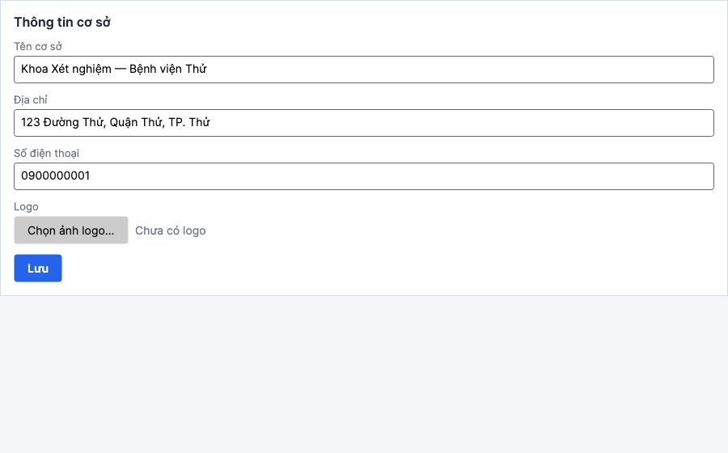
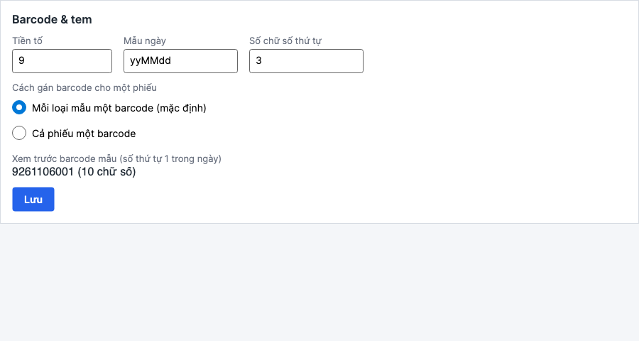
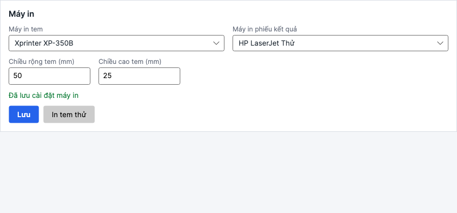
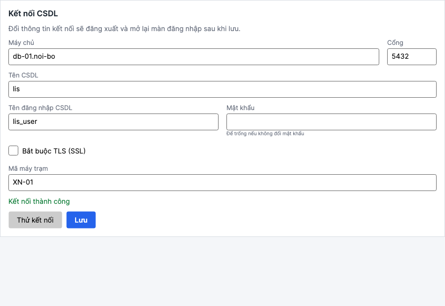
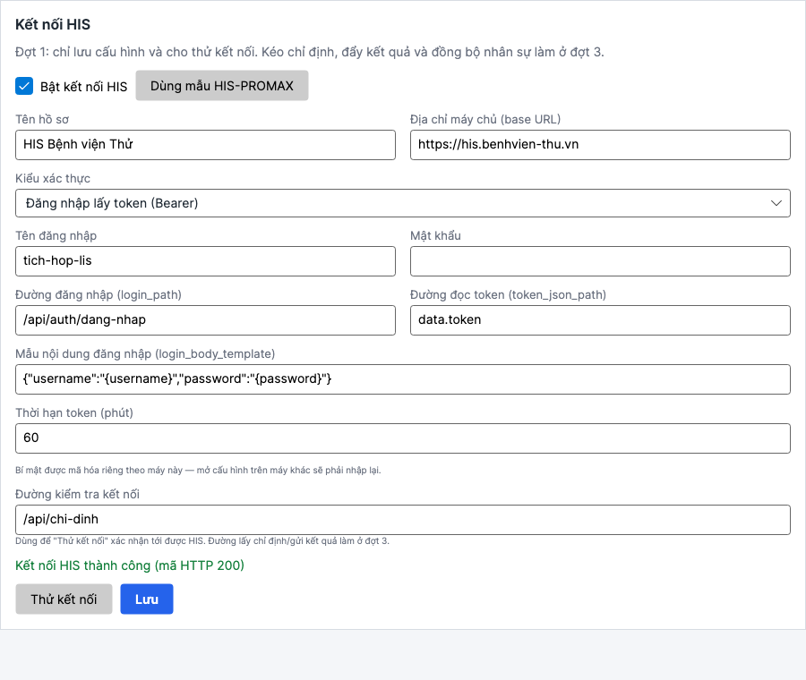
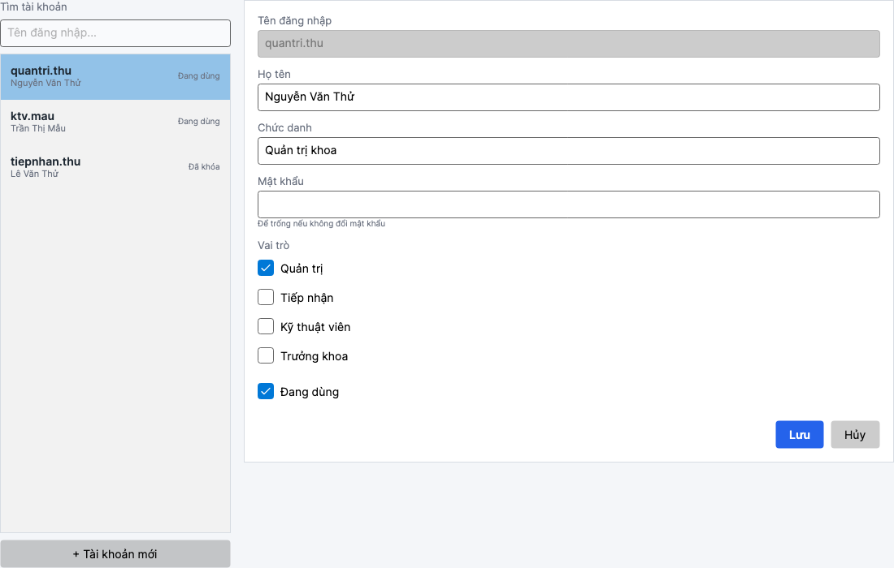
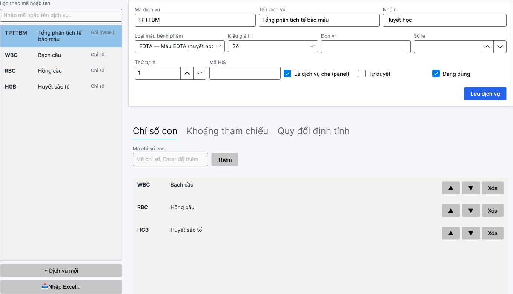
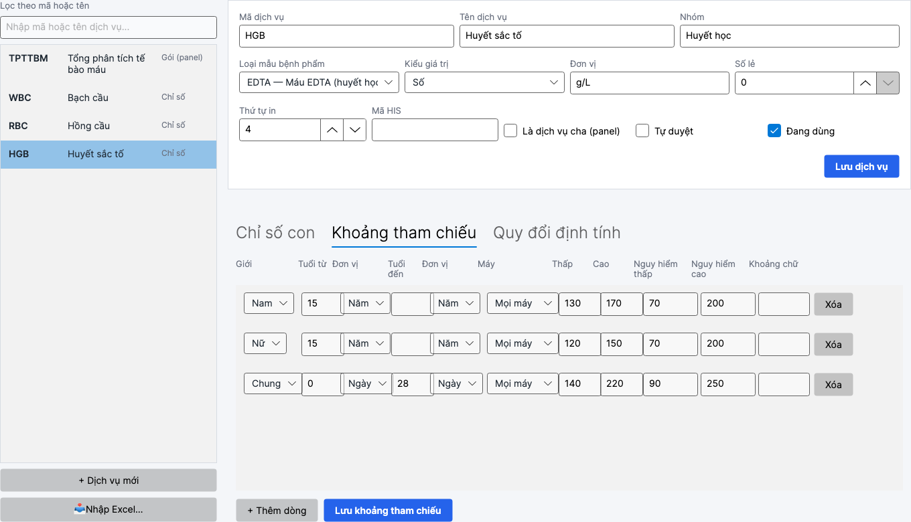
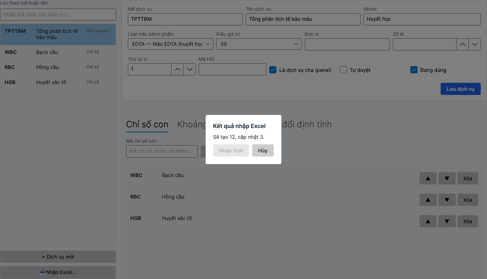
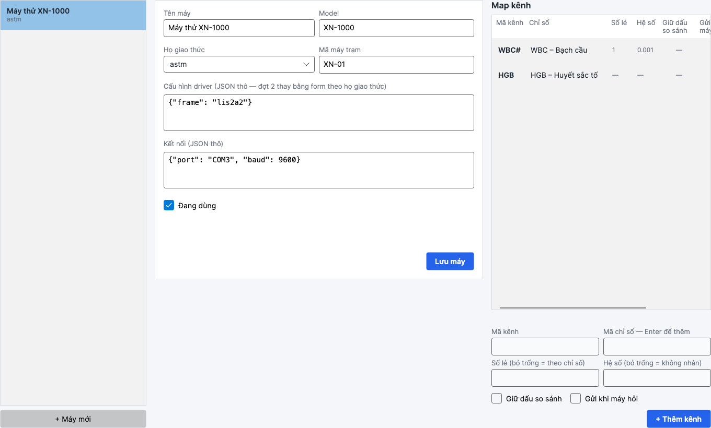

# Cấu hình LIS Connect

Dành cho quản trị hệ thống / trưởng khoa xét nghiệm. Hầu hết mục này nằm trong màn **Cài đặt**
(menu trái, chỉ tài khoản có vai trò **Quản trị** nhìn thấy) và các màn **Danh mục**, **Máy & map**,
**Tài khoản**.

## 1. Cài đặt → Thông tin cơ sở

Tab đầu tiên trong **Cài đặt**:

- **Tên cơ sở**, **Địa chỉ**, **Số điện thoại** — in trên đầu phiếu kết quả.
- **Logo**: nhấp **Chọn ảnh logo...**, chọn tệp ảnh — in kèm trên phiếu. Nhấp **Xóa logo** để bỏ.
- Nhấp **Lưu**.

## 2. Cài đặt → Barcode & tem

Quy định cách sinh mã barcode gán cho mỗi mẫu bệnh phẩm khi tiếp nhận:

- **Tiền tố**: chuỗi đứng đầu mọi barcode (mặc định `9`).
- **Mẫu ngày**: định dạng ngày chèn vào giữa barcode, viết theo cú pháp .NET (mặc định
  `yyMMdd` — ví dụ ngày 06/11/2026 ra `261106`).
- **Số chữ số thứ tự**: số chữ số của số thứ tự trong ngày (mặc định `3` → tối đa 999 mẫu/ngày
  cho cùng tiền tố+ngày; hết số sẽ báo lỗi "Hết số barcode trong ngày — tăng số chữ số thứ tự
  trong Cài đặt").

Ví dụ với tiền tố `9`, mẫu ngày `yyMMdd`, 3 chữ số thứ tự: mẫu thứ 1 trong ngày 06/11/2026 ra
barcode **`9261106001`**.

**Cách gán barcode cho một phiếu** (chọn một trong hai, áp dụng cho toàn hệ thống):

- **Mỗi loại mẫu một barcode (mặc định)**: một phiếu chỉ định có nhiều loại mẫu bệnh phẩm khác
  nhau (ví dụ máu EDTA + nước tiểu) thì mỗi loại mẫu được cấp **một barcode riêng**, dán lên ống
  tương ứng.
- **Cả phiếu một barcode**: toàn bộ các ống của một phiếu chỉ định dùng **chung một barcode**.

Khung "Xem trước barcode mẫu" hiện ngay kết quả ứng với số thứ tự 1 trong ngày, giúp kiểm tra
trước khi lưu.

**Lưu ý khi cấu hình cho cơ sở có kết nối máy xét nghiệm** (kết nối thật là tính năng Đợt 2):
nhiều máy xét nghiệm chỉ nhận mã ID có độ dài cố định (ví dụ 8 hoặc 10 chữ số) — cần tính trước
tổng độ dài `Tiền tố + Mẫu ngày (đã định dạng) + Số chữ số thứ tự` để không vượt quá giới hạn của
máy sẽ nối (xem tài liệu driver từng hãng ở [`docs/drivers/`](../drivers/README.md)).

Nhấp **Lưu**.

## 3. Cài đặt → Máy in

Có hai máy in cấu hình độc lập:

- **Máy in tem** (hoặc "Máy in tem (tên)" trên máy không liệt kê được danh sách máy in, như
  macOS/Linux dùng khi phát triển): máy in công suất nhỏ in tem nhiệt (A6 hoặc khổ tem thermal),
  khai thêm **Chiều rộng tem (mm)** / **Chiều cao tem (mm)**. Có nút **In tem thử** để kiểm tra
  không cần tạo mẫu thật.
- **Máy in phiếu kết quả** (hoặc "Máy in phiếu kết quả (tên)"): máy in A4 thông thường, in phiếu
  trả kết quả.

Trên Windows, hai ô này là **ComboBox** liệt kê sẵn các máy in đã cài trên hệ điều hành — chọn
trực tiếp, không cần gõ tên tay.

Nhấp **Lưu**.

## 4. Cài đặt → Kết nối CSDL

Xem lại/sửa thông tin kết nối CSDL đã nhập ở wizard cài đặt: **Máy chủ**, **Cổng**, **Tên CSDL**,
**Tên đăng nhập CSDL**, **Mật khẩu** (để trống nếu không đổi), **Bắt buộc TLS (SSL)**, **Mã máy
trạm**. Nhấp **Thử kết nối** trước khi **Lưu**.

**Đổi thông tin kết nối sẽ đăng xuất và mở lại màn đăng nhập sau khi lưu** — ứng dụng cần kết nối
lại bằng cấu hình mới.

## 5. Cài đặt → Kết nối HIS

**Đợt 1 chỉ lưu cấu hình và cho thử kết nối** — kéo chỉ định, đẩy kết quả và đồng bộ nhân sự thật
với HIS làm ở Đợt 3. Tab này chỉ hiện cho tài khoản Quản trị.

1. Tích **Bật kết nối HIS** để mở các trường còn lại.
2. **Kiểu xác thực** (ComboBox), có ba lựa chọn, mỗi kiểu hiện đúng các trường cần:
   - **Khóa API (header)** (`api-key`): nhập **Tên tiêu đề khóa API** (ví dụ `X-Integration-Key`)
     và **Khóa API**.
   - **Tài khoản/mật khẩu (Basic)** (`basic`): nhập **Tên đăng nhập** và **Mật khẩu**.
   - **Đăng nhập lấy token (Bearer)** (`bearer-login`): nhập **Tên đăng nhập**/**Mật khẩu**, cộng
     thêm **Đường đăng nhập (login_path)** (ví dụ `/api/v1/integration/auth/verify`), **Đường đọc
     token (token_json_path)** (ví dụ `data.token`), **Mẫu nội dung đăng nhập
     (login_body_template)** và **Thời hạn token (phút)**.
3. Nút **Dùng mẫu HIS-PROMAX** tự điền sẵn hồ sơ mẫu: xác thực `api-key`, đường kiểm tra kết nối
   là API công khai `/api/v1/system/info` của HIS-PROMAX. API đặt lệnh/kết quả/nhân sự thật của
   HIS-PROMAX **chưa có ở Đợt 1** — mẫu này chỉ dùng để kiểm tra kết nối tới được HIS.
4. **Đường kiểm tra kết nối** (`OrdersPath`): dùng cho nút **Thử kết nối**, không phải đường lấy
   chỉ định/gửi kết quả thật (việc đó ở Đợt 3).
5. Nhấp **Thử kết nối**, thấy thông báo thành công rồi **Lưu**.

**Bí mật mã hóa theo máy**: khóa API/mật khẩu nhập ở đây được **mã hóa riêng theo từng máy trạm**
— mở lại cấu hình trên máy khác phải nhập lại bí mật (chỉ hiện gợi ý, không hiện lại giá trị cũ
dù đã lưu, kể cả trên đúng máy đó — để trống ô khi sửa nghĩa là "không đổi bí mật đã lưu").

## 6. Tài khoản & vai trò

Màn **Tài khoản** (menu trái, chỉ Quản trị thấy): cột trái là danh sách tài khoản (lọc theo tên
đăng nhập), cột phải là form sửa/thêm.

### Bốn vai trò và quyền tương ứng

| Vai trò (mã) | Quyền |
|---|---|
| **Quản trị** (`quan-tri`) | Toàn bộ quyền — gồm cấu hình hệ thống, danh mục, tài khoản, máy, kết nối HIS/CSDL |
| **Tiếp nhận** (`tiep-nhan`) | Tiếp nhận người bệnh, lập chỉ định; xem kết quả |
| **Kỹ thuật viên** (`ky-thuat-vien`) | Xem/nhập/sửa kết quả, duyệt, ghép tay dòng "Chưa ghép", theo dõi máy, xem log thô |
| **Trưởng khoa** (`truong-khoa`) | Mọi quyền của Kỹ thuật viên **+ hủy duyệt** |

Một tài khoản có thể giữ **nhiều vai trò** cùng lúc (các ô tích ở form Tài khoản không loại trừ
nhau).

### Thêm tài khoản mới

Nhấp **+ Tài khoản mới**: nhập **Tên đăng nhập** (không đổi được sau khi tạo), **Họ tên**, **Chức
danh** (tùy chọn), **Mật khẩu** (tối thiểu 8 ký tự), tích ít nhất một **Vai trò**, **Đang dùng**
(tích sẵn). Nhấp **Lưu**.

### Sửa tài khoản / khóa, mở khóa

Chọn một tài khoản ở danh sách trái, sửa thông tin ở form phải (tên đăng nhập không sửa được),
bỏ tích **Đang dùng** để khóa tài khoản, để trống ô **Mật khẩu** nếu không đổi mật khẩu.

### Khóa tự động sau 5 lần sai mật khẩu

Hệ thống tự khóa tạm thời một tài khoản sau **5 lần nhập sai mật khẩu liên tiếp**, khóa trong
**15 phút** (đếm lại từ đầu sau đăng nhập đúng). Màn Đăng nhập hiện thông báo "Tài khoản tạm khóa
do nhập sai nhiều lần, thử lại sau N phút". Quản trị **không có nút mở khóa thủ công sớm hơn** ở
Đợt 1 — chỉ cần chờ hết thời gian khóa hoặc tự đăng nhập đúng (khóa tự hết khi còn hạn và đăng
nhập đúng mật khẩu thì không bị chặn thêm, bộ đếm sai được xóa khi đăng nhập thành công).

### Không thể khóa quản trị cuối cùng

Hệ thống luôn giữ **ít nhất một tài khoản Quản trị đang hoạt động**:

- Không tự khóa được tài khoản của chính mình, và không tự bỏ vai trò Quản trị của chính mình.
- Nếu đó là tài khoản Quản trị **đang hoạt động cuối cùng**, hệ thống báo lỗi "Phải còn ít nhất
  một tài khoản Quản trị đang hoạt động" và không lưu.

## 7. Danh mục dịch vụ

Màn **Danh mục** (chỉ Quản trị sửa được, cột trái là bảng dịch vụ có ô lọc theo mã/tên).

### Form sửa một dịch vụ

- **Mã dịch vụ**, **Tên dịch vụ**, **Nhóm** (tên nhóm hiển thị, tự do).
- **Loại mẫu bệnh phẩm** (ComboBox, lấy từ danh mục loại mẫu có sẵn trong CSDL).
- **Kiểu giá trị**: Số (`so`), Định tính (`dinh-tinh`) hoặc Chữ (`chu`).
- **Đơn vị**, **Số lẻ** (số chữ số sau dấu phẩy khi hiển thị/in, 0–4).
- **Thứ tự in** (số, dùng để sắp phiếu kết quả), **Mã HIS** (mã tương ứng bên HIS, dùng khi đồng
  bộ ở Đợt 3).
- **Là dịch vụ cha (panel)**: dịch vụ gộp nhiều chỉ số con (ví dụ "Công thức máu" gồm nhiều chỉ
  số như Hb, Hct, WBC...).
- **Tự duyệt**: đánh dấu dịch vụ (chỉ số lá) này được phép tự duyệt. Một **mẫu** chỉ tự chuyển
  sang **Đã duyệt** khi **toàn bộ** chỉ số lá của mẫu đó đều đánh dấu Tự duyệt, đều đã có giá trị
  hợp lệ, không cờ bất thường/nguy hiểm và không có bản thay thế đang chờ — việc tự duyệt chỉ
  được kiểm tra lại ngay sau khi **gán tay từ "Chưa ghép"** (xem
  [`03-su-dung.md`](03-su-dung.md#tự-duyệt)); **nhập/sửa giá trị trực tiếp ở màn Kết quả không tự
  duyệt** — luôn phải bấm **Duyệt (F10)**.
- **Đang dùng**: bỏ tích để ẩn dịch vụ khỏi danh sách chọn ở Tiếp nhận mà không xóa dữ liệu cũ.

### Dịch vụ cha – con (panel)

Khi tích **Là dịch vụ cha (panel)**, tab **Chỉ số con** bên dưới cho thêm các dịch vụ lá làm chỉ
số con: gõ mã chỉ số con vào ô, nhấn **Enter** hoặc nhấp **Thêm**, dùng nút **▲/▼** để sắp thứ tự
hiển thị, **Xóa** để gỡ. Khi tiếp nhận chọn dịch vụ cha, toàn bộ chỉ số con tự kéo theo (xem
[`03-su-dung.md`](03-su-dung.md)).

### Khoảng tham chiếu

Tab **Khoảng tham chiếu**: mỗi dòng là một khoảng áp dụng cho dịch vụ đang chọn, theo các cột:

| Cột | Ý nghĩa |
|---|---|
| Giới | Nam / Nữ / (để trống = chung cho cả hai giới) |
| Tuổi từ – Tuổi đến | Giới hạn tuổi áp dụng, kèm đơn vị tuổi (ngày/tháng/năm) riêng cho mỗi đầu |
| Máy | Khoảng chỉ áp dụng khi kết quả đến từ máy này (để trống = áp dụng mọi máy) |
| Thấp / Cao | Giới hạn bình thường — ngoài khoảng này gắn cờ ↑/↓ |
| Nguy hiểm thấp / Nguy hiểm cao | Ngưỡng báo nguy hiểm (‼) |
| Khoảng chữ | Dùng khi muốn hiện chữ thay số (ví dụ "Âm tính – Dương tính") thay vì bốn ô số |

**Quy tắc chọn khoảng khi nhiều dòng cùng khớp** một kết quả (cùng dịch vụ, người bệnh thỏa cả
giới/tuổi): hệ thống chọn khoảng **khớp nhất** — ưu tiên dòng có **giới tính khớp cụ thể** hơn
dòng giới để trống, và dòng có **khoảng tuổi hẹp hơn, khớp hơn** hơn dòng tuổi rộng/để trống;
dòng gắn **đúng máy đã sinh kết quả** được ưu tiên hơn dòng không gắn máy. Vì vậy nên khai đủ các
tổ hợp cần thiết (ví dụ Nam/Nữ riêng nếu khoảng khác nhau) và xếp các dòng hẹp, cụ thể cùng với
dòng rộng hơn — hệ thống tự chọn đúng dòng khớp nhất, không cần sắp xếp theo thứ tự ưu tiên tay.

Nhấp **+ Thêm dòng** để thêm, **Xóa** trên từng dòng để gỡ, **Lưu khoảng tham chiếu** để ghi.

### Quy đổi định tính

Tab **Quy đổi định tính** (áp dụng cho dịch vụ kiểu giá trị Định tính): mỗi dòng ánh xạ
**Giá trị thô** máy gửi về (hoặc nhập tay) sang **Hiển thị** trên phiếu, cho một **Máy** cụ thể
(hoặc để trống = mọi máy), kèm **Cờ** (Không/Thấp/Cao/Nguy hiểm thấp/Nguy hiểm cao/Bất thường).
Cờ "Bất thường" **chỉ sinh ra qua quy đổi định tính này** — không bao giờ do so sánh số với
khoảng tham chiếu.

### Nhập Excel

Nút **📥 Nhập Excel…** (chỉ Quản trị, nút mờ với vai trò khác) nạp danh mục từ một workbook
`.xlsx` có 4 sheet — đọc đúng theo `CatalogExcelImporter` (`src/Lis.Data/Catalog/CatalogExcelImporter.cs`):

| Sheet | Cột theo thứ tự (1-based) |
|---|---|
| **DichVu** | Mã, Tên, Nhóm, LoaiMau (mã loại mẫu, ví dụ `EDTA`, hoặc GUID), Đơn vị, KieuKetQua (`so`/`dinh-tinh`/`chu`), SoLe, ThuTuIn, LaPanel (true/false), TuDuyet (true/false), MaHIS |
| **ChiSoCon** | MaCha, MaCon — một dòng mỗi cặp cha–con |
| **KhoangThamChieu** | Mã, Gioi (`M`/`F`/trống), TuoiTu, TuoiDen, DonViTuoi (`nam`/`thang`/`ngay`), Thap, Cao, NguyHiemThap, NguyHiemCao, KhoangChu |
| **MapMay** | TenMay, MaKenh, MaChiSo, SoLe, HeSo, GiuDauSoSanh (true/false), GuiKhiMayHoi (true/false) |

Có tệp mẫu đã dựng sẵn: [`tools/seed/mau-danh-muc.xlsx`](../../tools/seed/mau-danh-muc.xlsx)
(cũng được chép vào gói `.zip` phân phối — xem [`01-cai-dat.md`](01-cai-dat.md)).

**Quy trình nhập**:

1. Nhấp **📥 Nhập Excel…**, chọn tệp `.xlsx`.
2. Ứng dụng tự chạy **kiểm tra trước (dryRun) — không ghi gì vào CSDL**, hiện panel kết quả:
   - Không lỗi: "Sẽ tạo X, cập nhật Y" — nút **Nhập thật** bật được.
   - Có lỗi: danh sách lỗi theo từng dòng, ví dụ `Sheet DichVu dòng 5: thiếu Mã` — nút **Nhập
     thật** bị mờ; sửa lại tệp Excel và chọn lại từ đầu.
3. Không có lỗi, nhấp **Nhập thật** để ghi thật vào CSDL (toàn bộ nằm trong **một giao dịch** —
   lỗi ở bất kỳ dòng nào sẽ hủy toàn bộ, không ghi một phần). Panel đổi sang "Đã tạo X, cập nhật
   Y", danh sách dịch vụ tự nạp lại.
4. **Hủy** (trước khi nhập thật) hoặc **Đóng** (sau khi đã nhập thật) để tắt panel.

**Luôn chạy thử (dryRun hiện ra tự động) trước khi nhập thật** — đây là hành vi mặc định của nút,
không cần bật riêng.

## 8. Máy xét nghiệm & map kênh

Màn **Máy & map** (chỉ Quản trị sửa được): cột trái danh sách máy, giữa là form máy, phải là bảng
map kênh của máy đang chọn.

**Lưu ý phạm vi Đợt 1**: đây là nơi **khai báo định nghĩa** máy và cách map kết quả — **chưa kết
nối thật** tới máy xét nghiệm qua LAN/USB (việc đó là Đợt 2). Ở Đợt 1, cấu hình driver/kết nối là
**JSON thô**, nhập tay tạm thời; Đợt 2 sẽ thay bằng form riêng theo từng họ giao thức.

### Form máy

- **Tên máy**, **Model**.
- **Họ giao thức**: ComboBox tự do gồm `astm`, `hl7`, `csv`, `khac` — Đợt 1 chỉ là nhãn phân loại,
  Đợt 2 mới gắn driver thật theo từng họ.
- **Mã máy trạm**: máy trạm (PC) nào sẽ nhận dữ liệu từ máy này (dùng ở Đợt 2).
- **Cấu hình driver (JSON thô)** và **Kết nối (JSON thô)**: hai ô nhập JSON tự do, tạm thời ở Đợt 1.
- **Đang dùng**. Nhấp **Lưu máy**.

### Map kênh

Mỗi dòng map **một kênh của máy** (`Mã kênh` — mã do máy gửi kèm kết quả) sang **một chỉ số**
(dịch vụ lá, không phải panel) trong danh mục:

| Trường | Ý nghĩa |
|---|---|
| Mã kênh | Mã kênh/tham số máy gửi, dùng để khớp khi nhận kết quả |
| Mã chỉ số | Dịch vụ lá tương ứng (gõ mã, Enter để thêm) — **không map được tới dịch vụ cha (panel)** |
| Số lẻ | Số chữ số sau dấu phẩy khi ghi nhận giá trị từ kênh này — để trống dùng số lẻ của chỉ số |
| Hệ số | Nhân giá trị thô của máy với hệ số này trước khi lưu (để trống = không nhân) |
| Giữ dấu so sánh | Giữ các dấu `<`, `>`, `<=`, `>=` máy gửi kèm giá trị (ví dụ `<0.1`) thay vì chỉ lấy số |
| Gửi khi máy hỏi | Kênh này được trả lại khi máy "hỏi" worklist (dùng ở Đợt 2) |

**Ràng buộc một kênh một chỉ số**: mỗi `(Máy, Mã kênh)` chỉ map tới **đúng một** chỉ số — không
thể gán hai chỉ số khác nhau cho cùng một mã kênh của cùng một máy; map tới dịch vụ cha (panel)
bị chặn với thông báo "Kênh máy chỉ map tới chỉ số lá, không map tới dịch vụ cha (panel)".

Dùng nút **Sửa**/**Xóa** trên mỗi dòng để sửa hoặc gỡ map kênh đã có.

