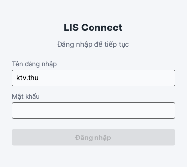
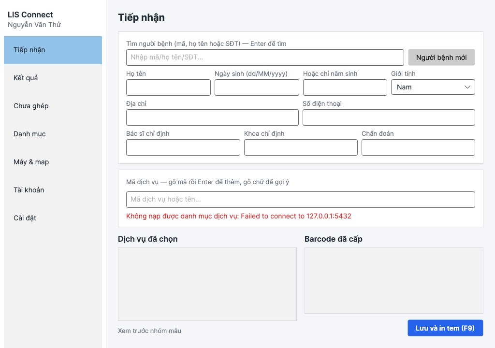
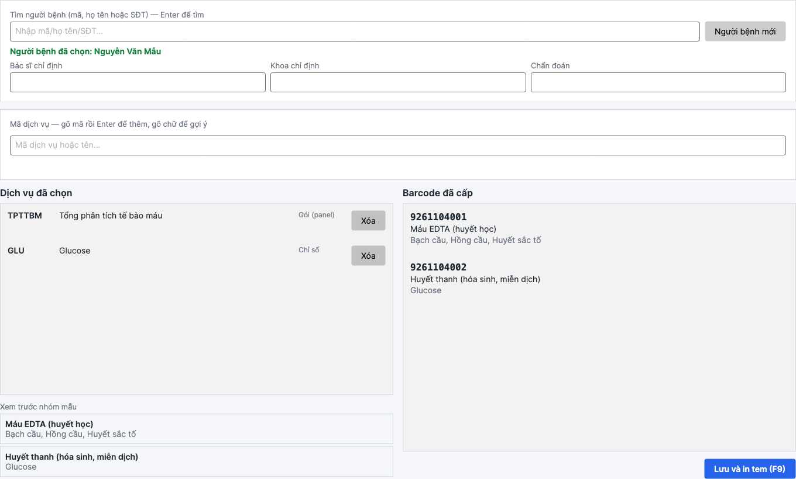
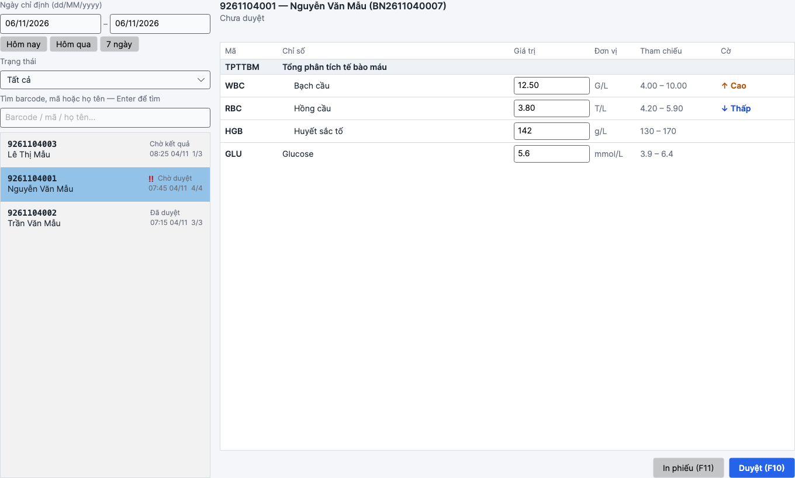
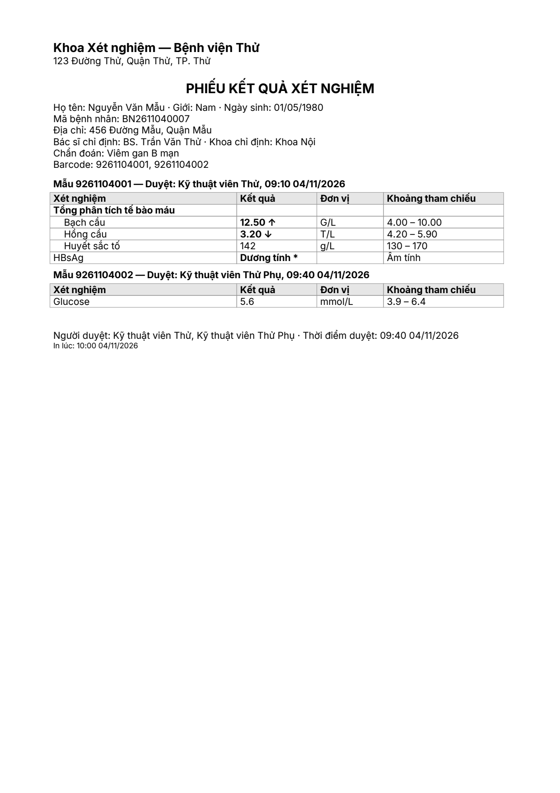
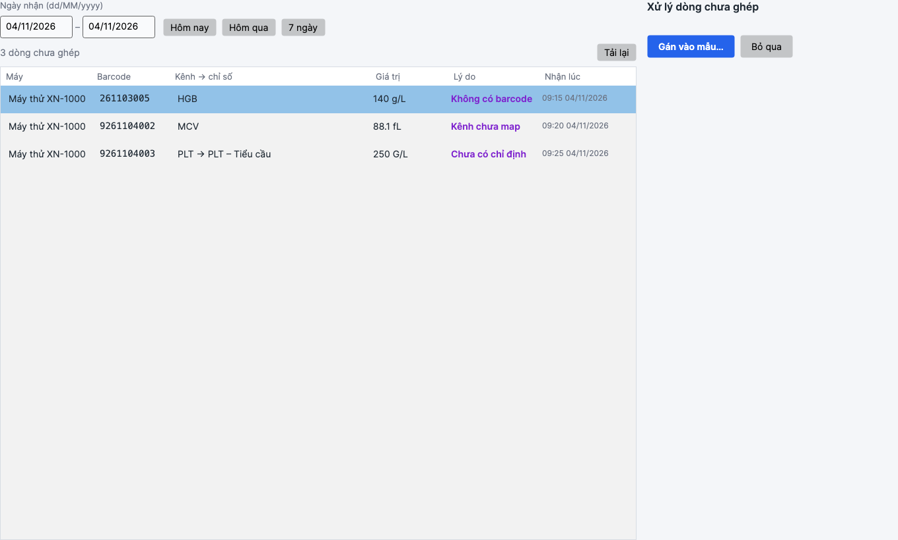

# Sử dụng hằng ngày

Dành cho nhân viên tiếp nhận và kỹ thuật viên xét nghiệm. LIS Connect theo nguyên tắc **tối ưu
bàn phím**: gõ mã rồi Enter thay vì dùng chuột, Enter chuyển sang ô kế tiếp trên các form.

Đăng nhập ở màn hình đầu (**Tên đăng nhập**, **Mật khẩu**) — menu bên trái sau khi đăng nhập chỉ
hiện các mục theo đúng quyền của vai trò tài khoản đang dùng (xem bảng quyền ở
[`02-cau-hinh.md`](02-cau-hinh.md#6-tài-khoản--vai-trò)).




## 1. Tiếp nhận (vai trò Tiếp nhận / Quản trị)

Màn **Tiếp nhận**: khung trên tìm/nhập người bệnh, khung giữa chọn dịch vụ, khung dưới xem lại
và lưu.

### Tìm hoặc thêm người bệnh

1. Gõ mã, họ tên hoặc số điện thoại vào ô **Tìm người bệnh**, nhấn **Enter**. Kết quả hiện ở danh
   sách ngay dưới — nhấp chọn một dòng để chọn người bệnh đó (dòng "Người bệnh đã chọn: ..." hiện
   ra).
2. Không tìm thấy, nhấp **Người bệnh mới** để mở các ô nhập mới: **Họ tên**, **Ngày sinh
   (dd/MM/yyyy)** hoặc **Hoặc chỉ năm sinh** (khi không rõ ngày/tháng sinh), **Giới tính**, **Địa
   chỉ**, **Số điện thoại**.
3. Nhập thêm **Bác sĩ chỉ định**, **Khoa chỉ định**, **Chẩn đoán** (áp dụng cho chỉ định đang lập).

### Chọn dịch vụ

Gõ mã dịch vụ vào ô **Mã dịch vụ**, nhấn **Enter** để thêm thẳng vào danh sách đã chọn. Gõ chữ
(một phần mã hoặc tên) sẽ hiện danh sách gợi ý ngay dưới ô — nhấp chọn một dòng gợi ý để thêm.

Khi chọn một **dịch vụ cha (panel)**, toàn bộ **chỉ số con** khai trong Danh mục tự kéo theo vào
danh sách đã chọn — không cần gõ từng chỉ số con một.

### Xem trước nhóm mẫu

Khung **Xem trước nhóm mẫu** tự tính các dịch vụ đã chọn sẽ gom vào **mấy mẫu (ống)**, theo đúng
chế độ barcode đã cấu hình ở **Cài đặt → Barcode & tem**:

- **Mỗi loại mẫu một barcode**: mỗi loại mẫu bệnh phẩm khác nhau (vd máu EDTA, nước tiểu) ra một
  nhóm riêng, mỗi nhóm sẽ nhận một barcode.
- **Cả phiếu một barcode**: luôn gom thành một nhóm duy nhất.

### Lưu và in tem

Nhấp **Lưu và in tem (F9)** hoặc nhấn phím **F9**. Ứng dụng tạo chỉ định, cấp barcode theo từng
nhóm mẫu, hiện danh sách ở khung **Barcode đã cấp** (barcode, loại mẫu, tên các dịch vụ trong mẫu
đó), và gửi lệnh in tem tới **máy in tem** đã cấu hình.



## 2. Kết quả (vai trò Kỹ thuật viên / Trưởng khoa / Quản trị)

Màn **Kết quả**: cột trái danh sách mẫu có bộ lọc, cột phải bảng chỉ số của mẫu đang chọn.

### Lọc danh sách mẫu

- **Ngày chỉ định**: khai khoảng ngày (dd/MM/yyyy), hoặc dùng nút tắt **Hôm nay** / **Hôm qua** /
  **7 ngày**.
- **Trạng thái**: lọc theo trạng thái duyệt.
- **Tìm barcode, mã hoặc họ tên**: gõ rồi **Enter** để tìm.

Mỗi dòng mẫu hiện barcode, cờ **‼** (có chỉ số nguy hiểm) hoặc **⟳** (máy gửi lại kết quả — có
bản thay thế chờ xử lý) nếu có, trạng thái, tên người bệnh, thời điểm chỉ định và tiến độ (số chỉ
số đã có giá trị / tổng số).

### Nhập/sửa kết quả

Chọn một mẫu, bảng chỉ số hiện bên phải (dịch vụ cha hiện dòng tiêu đề nền nhạt, chỉ số con thụt
vào dưới). Với mỗi chỉ số:

1. Nhấp vào ô **Giá trị**, gõ giá trị, nhấn **Enter** để ghi — con trỏ tự nhảy xuống ô giá trị
   sửa được kế tiếp.
2. Nhấn **Esc** để hủy, trả ô về giá trị đã lưu trước đó (nếu có).
3. **Sửa một ô đã có giá trị bắt buộc nhập lý do**: khung **Lý do sửa kết quả** hiện ra, gõ lý do
   rồi **Enter** để ghi cùng lúc.
4. Giá trị kiểu Số gõ không đọc được thành số (ví dụ `abc`, `12..5`) bị từ chối ngay, không lưu.

### Cờ cảnh báo

Cột **Cờ** hiện: **↑ Cao**, **↓ Thấp** (ngoài khoảng tham chiếu bình thường), **‼ Nguy hiểm**
(vượt ngưỡng nguy hiểm thấp/cao), hoặc **Bất thường** (chỉ sinh từ quy đổi định tính, không bao
giờ do so sánh số).

### Duyệt / hủy duyệt

- **Duyệt (F10)**: duyệt toàn bộ mẫu đang chọn (cần ít nhất một chỉ số đã có giá trị). Sau khi
  duyệt, các ô giá trị không còn sửa được trực tiếp.
- **Hủy duyệt** (chỉ Trưởng khoa/Quản trị thấy nút): bắt buộc nhập **lý do hủy duyệt** ở khung
  hiện ra, nhấp **Xác nhận hủy duyệt** (hoặc Enter trong ô lý do) để mở lại mẫu cho sửa; **Không**
  để hủy bỏ.

### Tự duyệt

Một mẫu **tự chuyển sang Đã duyệt** (không cần bấm F10) khi **mọi** chỉ số lá của mẫu đó đều đánh
dấu **Tự duyệt** trong Danh mục, đều đã có giá trị, không cờ bất thường/nguy hiểm, và không còn
bản thay thế đang chờ. Việc này được kiểm tra lại **ngay sau khi gán tay một dòng từ "Chưa ghép"
vào mẫu** (xem mục 4) — **gõ/sửa giá trị trực tiếp ở màn Kết quả không kích hoạt tự duyệt**, luôn
cần bấm **Duyệt (F10)**.

### Bản thay thế khi máy gửi lại cho mẫu đã duyệt

Nếu một mẫu **đã duyệt** nhận thêm một giá trị mới cho cùng chỉ số (ví dụ máy chạy lại), giá trị
mới không ghi đè ngay — hiện là **"Máy gửi lại: ..."** kèm hai nút:

- **Chấp nhận**: ghi giá trị mới, tính lại cờ/khoảng tham chiếu.
- **Bỏ bản thay thế**: giữ nguyên giá trị đã duyệt, bỏ giá trị mới.

(Luồng gửi kết quả thật từ máy xét nghiệm là tính năng Đợt 2 — mục này mô tả cách xử lý khi có
dữ liệu dạng "bản thay thế", không phải cách nối máy.)

### In phiếu (F11)

Nhấp **In phiếu (F11)** hoặc nhấn **F11**: in phiếu kết quả cho mẫu đang chọn, **gộp các ống cùng
một phiếu chỉ định** (nếu một phiếu có nhiều mẫu/barcode). Nếu **còn mẫu nào của phiếu chưa
duyệt**, phiếu in ra có dòng cảnh báo **"CHƯA DUYỆT — KHÔNG CÓ GIÁ TRỊ TRẢ KẾT QUẢ"** ở đầu và cuối
phiếu.




## 3. Chưa ghép (vai trò Kỹ thuật viên / Trưởng khoa / Quản trị)

Màn **Chưa ghép**: nơi xử lý các dòng kết quả **không tự khớp được** với một chỉ định (luồng
nhận dữ liệu máy xét nghiệm thật thuộc Đợt 2 — màn này đã có sẵn ở Đợt 1 để chuẩn bị, và cũng
nhận các dòng được đưa vào qua công cụ tạo dữ liệu demo).

### Ba lý do chưa ghép

| Lý do | Ý nghĩa |
|---|---|
| **Không có barcode** | Dòng kết quả không kèm mã barcode để tra |
| **Chưa có chỉ định** | Barcode hợp lệ nhưng không khớp chỉ định nào đang chờ |
| **Kênh chưa map** | Barcode khớp chỉ định, nhưng mã kênh máy gửi chưa được map tới chỉ số nào (xem [`02-cau-hinh.md`](02-cau-hinh.md#8-máy-xét-nghiệm--map-kênh)) |

### Lọc và xử lý

1. Lọc theo **Ngày nhận** (dd/MM/yyyy, có nút **Hôm nay**/**Hôm qua**/**7 ngày**), nhấp **Tải
   lại** khi cần nạp lại danh sách.
2. Chọn một dòng ở bảng, dùng:
   - **Gán vào mẫu…**: mở khung nhập **Barcode mẫu**, gõ rồi **Enter** để tra, chọn đúng chỉ số
     cần gán ở danh sách hiện ra, nhấp **Gán**. Sau khi gán, hệ thống tự kiểm tra lại điều kiện
     **tự duyệt** cho mẫu đó (mục 2).
   - **Bỏ qua**: bắt buộc nhập **lý do bỏ qua** ở khung hiện ra rồi **Enter** hoặc nhấp **Xác
     nhận bỏ qua**; **Không** để hủy bỏ.



## 4. Dữ liệu demo (dùng để kiểm thử, huấn luyện)

Công cụ dòng lệnh `Lis.SeedTool.exe` (trong thư mục `seedtool\` của bản phân phối) có lệnh
`seed-demo` để tạo người bệnh, phiếu chỉ định và kết quả **giả lập** (không phải dữ liệu thật):

```bash
Lis.SeedTool.exe seed-demo --conn "Host=localhost;Port=5432;Database=lis;Username=lis_user;Password=mat-khau-lis" --days 3
```

- `--conn`: chuỗi kết nối tới CSDL (bắt buộc).
- `--days`: số ngày lùi về trước để tạo dữ liệu (ví dụ `3` = tạo dữ liệu rải trong 3 ngày qua).

Dữ liệu demo gồm bệnh nhân có tên chứa "Mẫu" hoặc "Thử", phiếu xét nghiệm, kết quả (hoàn thành
hoặc chờ duyệt) — nhận biết dễ dàng để không nhầm với dữ liệu thật, **không nên chạy lệnh này
trên CSDL đang dùng để khám bệnh thật**.

## 5. Phím tắt

| Phím | Màn | Tác dụng |
|---|---|---|
| **Enter** | Mọi ô nhập trên form (trừ các trường hợp có hành vi riêng dưới đây) | Chuyển sang ô kế tiếp |
| **Enter** | Ô tìm người bệnh (Tiếp nhận) | Tìm người bệnh |
| **Enter** | Ô mã dịch vụ (Tiếp nhận) | Thêm dịch vụ vào danh sách đã chọn |
| **F9** | Tiếp nhận | Lưu chỉ định và in tem |
| **Enter** | Ô giá trị chỉ số (Kết quả) | Ghi giá trị, chuyển xuống ô giá trị kế tiếp |
| **Esc** | Ô giá trị chỉ số (Kết quả) | Hủy sửa, trả lại giá trị đã lưu |
| **Enter** | Ô lý do sửa kết quả (Kết quả) | Ghi dòng đang sửa kèm lý do |
| **Enter** | Ô tìm kiếm (Kết quả) | Lọc lại danh sách mẫu |
| **Enter** | Ô lý do hủy duyệt (Kết quả) | Xác nhận hủy duyệt |
| **F10** | Kết quả | Duyệt mẫu đang chọn |
| **F11** | Kết quả | In phiếu kết quả |
| **Enter** | Ô thêm chỉ số con (Danh mục) | Thêm chỉ số con |
| **Enter** | Ô mã chỉ số của map kênh (Máy & map) | Thêm map kênh |
| **Enter** | Ô barcode tra mẫu (Chưa ghép — khung "Gán vào mẫu…") | Tra barcode |
| **Enter** | Ô lý do bỏ qua (Chưa ghép) | Xác nhận bỏ qua |

## 6. Câu hỏi thường gặp

**Vì sao không thấy mục Danh mục / Máy & map / Tài khoản / Cài đặt trên menu trái?**
Bốn mục này chỉ hiện cho tài khoản có vai trò **Quản trị**. Liên hệ quản trị viên nếu cần quyền.

**Nhập sai giá trị đã duyệt thì sửa thế nào?**
Cần **Hủy duyệt** trước (chỉ Trưởng khoa/Quản trị thực hiện được, kèm lý do), sau đó mới sửa lại
giá trị trong màn Kết quả (vẫn cần nhập lý do sửa vì ô đã có giá trị cũ) rồi duyệt lại.

**Tại sao bấm Lưu và in tem nhưng không thấy tem in ra?**
Kiểm tra **Cài đặt → Máy in** đã chọn đúng **Máy in tem**, máy đang bật và có giấy/ruy băng; dùng
nút **In tem thử** để kiểm tra riêng khâu in, không cần tạo mẫu mới. Xem thêm
[`04-xu-ly-su-co.md`](04-xu-ly-su-co.md).

**Vì sao một dịch vụ cha (panel) không cho nhập giá trị trực tiếp?**
Dịch vụ cha chỉ là nhóm hiển thị của các chỉ số con — chỉ chỉ số con (lá) mới có ô giá trị.

**Tài khoản báo "tạm khóa do nhập sai nhiều lần" thì làm sao?**
Chờ hết thời gian khóa ghi trong thông báo (tối đa 15 phút) rồi đăng nhập lại — xem
[`02-cau-hinh.md`](02-cau-hinh.md#khóa-tự-động-sau-5-lần-sai-mật-khẩu).
